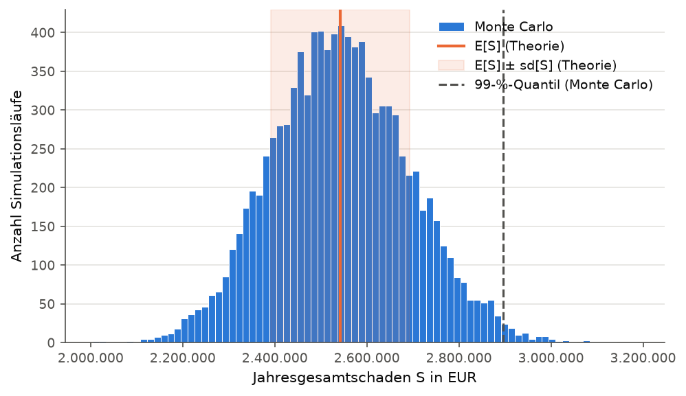
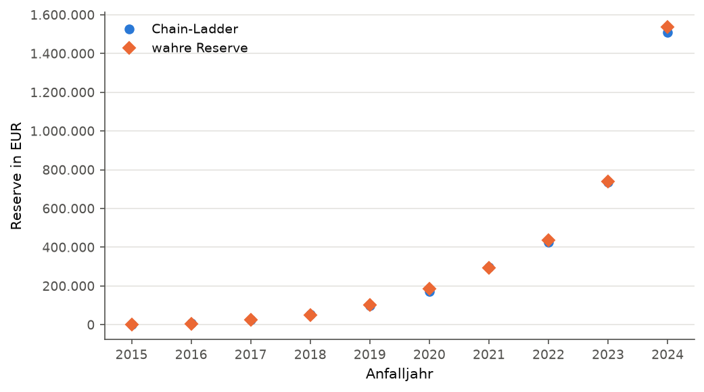
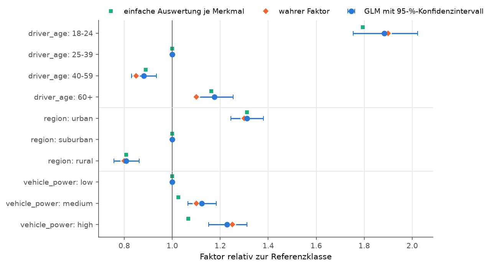
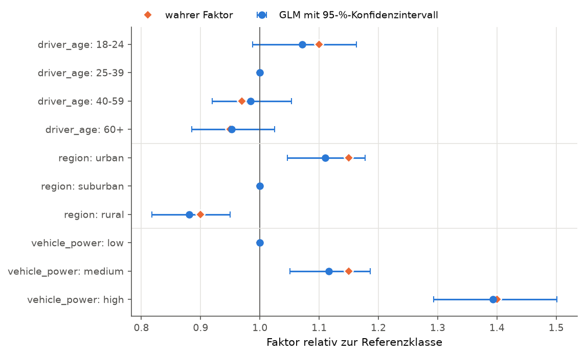

# Schadenmodellierung für ein Kfz-Portfolio

Dieses Projekt modelliert die Schäden eines simulierten Kfz-Portfolios in drei Teilen: Gesamtschaden im kollektiven Modell, Reservierung mit Chain-Ladder und Tarifierung mit Poisson- und Gamma-GLM; jede Schätzung wird gegen die bekannten wahren Parameter der Simulation geprüft. Es richtet sich an Leserinnen und Leser aus Aktuariat und versicherungsnaher IT.

## Ergebnisse auf einen Blick

Alle Zahlen und Grafiken stammen aus `nonlife run --seed 42` (Standardargumente: 10.000 Policen je Anfalljahr, Anfalljahre 2015–2024, Stichtag Ende 2024, 10.000 Monte-Carlo-Läufe). Der Lauf erzeugt 100.000 Policen, 7.192 Schäden und 39.426 Zahlungen. Die vollständigen Kennzahlen stehen in [`reports/results.json`](reports/results.json).

### Gesamtschaden: Simulation gegen Theorie



Die Monte-Carlo-Verteilung der Jahresschadenlast trifft den theoretischen Erwartungswert auf 0,04 % und die theoretische Standardabweichung auf 1,8 %.

| | Simulation | Theorie |
|---|---:|---:|
| $E[S]$ | 2.542.947 | 2.542.015 |
| $\mathrm{sd}[S]$ | 148.245 | 151.007 |
| 99-%-Quantil | 2.895.916 | – |

Parameter: $\hat\lambda = 719{,}2$ Schäden je Jahr, Schwere Lognormal mit $\hat\mu = 7{,}7046$, $\hat\sigma = 0{,}9651$.

### Reserve: Chain-Ladder gegen wahre Reserve



Die Chain-Ladder-Reserve liegt insgesamt 1,3 % unter der wahren Reserve; je Anfalljahr reicht die Abweichung von −6,5 % (2020) bis +3,4 % (2018), nur das fast abgewickelte Jahr 2016 weicht bei sehr kleinem Betrag stark ab (7.678 gegen 4.723). Ein Mack-Intervall fehlt noch (siehe [Geplant](#geplant)).

| | Chain-Ladder | wahr | Abweichung |
|---|---:|---:|---:|
| Reserve gesamt | 3.326.580 | 3.371.937 | −1,3 % |

### Tariffaktoren: GLM gegen wahre Faktoren



Das Poisson-GLM trifft die wahren Frequenzfaktoren; die einfache Auswertung je Merkmal ist für `vehicle_power` deutlich verzerrt (Klasse `high`: einfach 1,066, GLM 1,229, wahr 1,25), weil junge Fahrer mit hoher Frequenz überwiegend schwach motorisierte Fahrzeuge fahren und so die Referenzklasse `low` verteuern. Von den sieben geschätzten Frequenzfaktoren liegt bei einem der wahre Wert knapp außerhalb des 95-%-Intervalls: `driver_age: 60+` mit GLM 1,176, Intervall [1,103; 1,254], wahr 1,10. Bei sieben Intervallen zum Niveau 95 % ist das kein Widerspruch zum Modell.



Das Gamma-GLM trifft die wahren Schwerefaktoren; alle sieben 95-%-Intervalle enthalten den wahren Wert (z. B. `vehicle_power: high`: GLM 1,393, wahr 1,40).

## Methodik

### Kollektives Modell ([`collective.py`](src/nonlife/collective.py))

Jahresgesamtschaden $S = X_1 + \dots + X_N$ mit $N \sim \text{Poisson}(\lambda)$ und u.i.v. Schadenhöhen $X_k \sim \text{Lognormal}(\mu, \sigma^2)$, unabhängig von $N$. Dann gilt

$$E[S] = E[N]\,E[X], \qquad \operatorname{Var}[S] = E[N]\operatorname{Var}[X] + \operatorname{Var}[N]\,E[X]^2 = \lambda\,E[X^2].$$

Das Portfolio ist heterogen: Police $i$ hat die Schadenanzahl $N_i \sim \text{Poisson}(\lambda_i)$ mit $\lambda_i = \lambda(x_i)\,e_i$. Die Summe unabhängiger zusammengesetzter Poisson-Variablen ist wieder zusammengesetzt Poisson mit $\lambda = \sum_i \lambda_i$ und der Mischung $\sum_i (\lambda_i/\lambda)\,F_i$ der Schwereverteilungen. Daher darf das Portfolio als ein kollektives Modell behandelt werden. Geschätzt wird $\hat\lambda$ als Schadenfrequenz je Exposure-Jahr mal mittlere Exposure eines Anfalljahres, $(\hat\mu, \hat\sigma)$ per Maximum-Likelihood aus allen Einzelschäden.

Die Monte-Carlo-Simulation ist vektorisiert: alle Schadenanzahlen in einem Aufruf, danach alle Schadenhöhen in einem Block, Summe je Lauf mit `np.bincount`. Zufall kommt ausschließlich aus einem übergebenen `numpy.random.Generator`.

### Reservierung ([`reserving.py`](src/nonlife/reserving.py))

Kumuliertes Zahlungsdreieck $C_{i,j}$ (Anfalljahr $i$, Abwicklungsjahr $j$) aus den Einzelzahlungen bis zum Stichtag. Volumengewichtete Entwicklungsfaktoren

$$\hat f_j = \frac{\sum_i C_{i,j+1}}{\sum_i C_{i,j}},$$

summiert über alle Anfalljahre, für die beide Werte beobachtet sind. Hochrechnung und Reserve:

$$\hat C_{i,J} = C_{i,I-i} \prod_{j \ge I-i} \hat f_j, \qquad \hat R_i = \hat C_{i,J} - C_{i,I-i}.$$

Die wahre Reserve je Anfalljahr ist der simulierte Endschaden minus die bis zum Stichtag gezahlten Beträge. Die Chain-Ladder-Funktionen sind gegen das Paket [`chainladder`](https://github.com/casact/chainladder-python) auf dem RAA-Dreieck aus Mack (1993) getestet; das Paket wird nur in den Tests verwendet.

### Tarifierung ([`pricing.py`](src/nonlife/pricing.py))

Frequenz: Poisson-GLM mit Log-Link und $\log e_i$ als Offset (Koeffizient fest 1, da $E[N_i]$ proportional zur Exposure),

$$\log E[N_i] = \log e_i + \beta_0 + \sum_m \beta_{m, x_{im}}.$$

Schwere: Gamma-GLM mit Log-Link auf den Einzelschäden, $\log E[X_k] = \gamma_0 + \sum_m \gamma_{m, x_{km}}$. Das Gamma-GLM unterstellt einen konstanten Variationskoeffizienten; das gilt für die simulierten lognormalen Schäden, sodass die Schätzer als Quasi-Likelihood-Schätzer konsistent sind. Die Dispersion wird über die Pearson-Statistik geschätzt.

Kategoriale Merkmale gehen mit Treatment-Kodierung ein, die Designmatrix wird selbst gebaut, damit die Referenzklasse frei wählbar ist. Tariffaktoren sind $e^{\hat\beta}$, die Konfidenzintervalle $\exp(\hat\beta \pm z_{1-\alpha/2}\,\widehat{\mathrm{se}})$ (Wald-Intervall auf der Log-Skala, daher asymmetrisch um den Faktor). Zum Vergleich wird die einfache Auswertung je Merkmal $(N_\ell/E_\ell)/(N_\text{ref}/E_\text{ref})$ gezeigt; sie entspricht einem Poisson-GLM mit nur diesem Merkmal. Geschätzt wird mit `statsmodels`.

## Daten

- **Synthetisches Portfolio** ([`simulate.py`](src/nonlife/simulate.py)): Tarifmerkmale `driver_age`, `region` und `vehicle_power`, wobei `vehicle_power` bewusst von `driver_age` abhängt. Frequenz und mittlere Schadenhöhe sind multiplikativ in den Merkmalen, die wahren Faktoren sind bekannt (`default_parameters`). Schadenanzahl Poisson mit Exposure, Schadenhöhe lognormal mit festem Variationskoeffizienten. Jeder Schaden wird über zehn Abwicklungsjahre ausgezahlt; die Zahlungsanteile sind Dirichlet-verteilt um ein festes Abwicklungsmuster, damit die Entwicklungsfaktoren zwischen Anfalljahren streuen. Zahlungen nach dem Stichtag werden abgeschnitten und liefern die wahre Reserve.
- **freMTPL2** (*offen*): französisches Kfz-Haftpflicht-Portfolio auf OpenML ([freMTPL2freq, ID 41214](https://www.openml.org/d/41214), [freMTPL2sev, ID 41215](https://www.openml.org/d/41215)). Es soll bei Bedarf geladen und unter `data/` zwischengespeichert werden; ausgewertet ist es noch nicht.

Erzeugte und heruntergeladene Daten liegen unter `data/` und werden nicht eingecheckt.

## Installation und Reproduktion

Python 3.11 oder neuer.

```bash
python -m venv .venv
source .venv/bin/activate        # Windows: .venv\Scripts\activate
pip install -e ".[dev]"

nonlife run                      # Seed 42; erzeugt data/, reports/results.json, reports/figures/
pytest
ruff check .
mypy src
```

## Grenzen

- **Schwere im kollektiven Modell:** Für das gesamte Portfolio wird eine einzige Lognormalverteilung angepasst. Die wahre Schwere ist eine Mischung von Lognormalverteilungen über die Tarifklassen.
- **Zahlungs- statt Aufwandsdreieck:** Es gibt keine Spätmeldungen und keine Einzelfallreserven; jeder Schaden ist im Anfalljahr bekannt. Die Reserve ist hier die Summe der ausstehenden Zahlungen, kein IBNR im engeren Sinn.
- **Kein Tail-Faktor:** Das Abwicklungsmuster endet nach zehn Jahren und damit innerhalb des Dreiecks.
- **Keine Inflation, stationäres Portfolio:** Muster, Faktoren und Portfoliogröße sind über alle Anfalljahre gleich.
- **Synthetische, korrekt spezifizierte Daten:** Die GLMs schätzen genau die Modellklasse, aus der die Daten stammen. Fehlspezifikation, Interaktionen und Großschäden kommen nicht vor; das zeigen erst echte Daten wie freMTPL2.

## Geplant

- Panjer-Rekursion mit diskretisierter Schwere, Vergleich der Quantile und der Laufzeit mit Monte Carlo
- Standardfehler der Reserve nach Mack (1993) und Intervall in der Reservegrafik
- Frequenz-GLM auf freMTPL2

Für Panjer und Mack sind Signaturen und Tests vorhanden; die Tests laufen als `xfail`, bis die Funktionen implementiert sind.

## Entstehung

Die Chain-Ladder-Funktionen (`calculate_development_factors`, `project_triangle`, `calculate_reserve`) hat Linus Plümer selbst geschrieben. Für die übrige Kernlogik hat er Signaturen, fachliche Annahmen und Tests festgelegt und freigegeben; implementiert wurde sie mit Claude Code und anschließend gemeinsam reviewt. Projektstruktur, Tooling, CLI und Grafiken stammen weitgehend von Claude Code.
