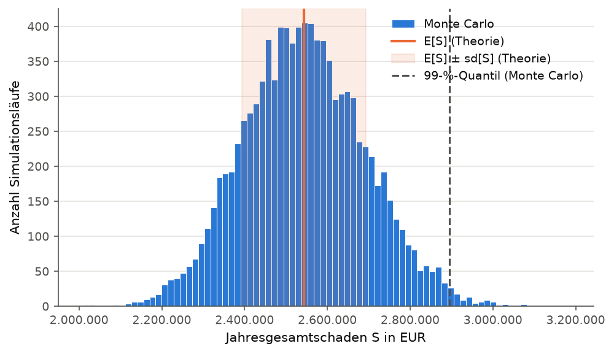
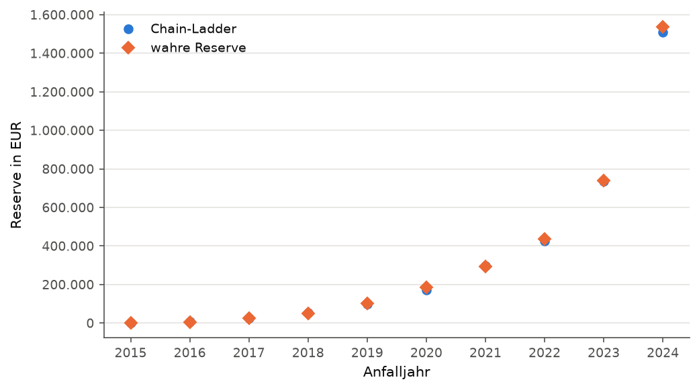
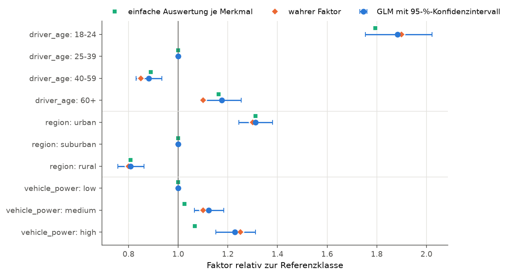
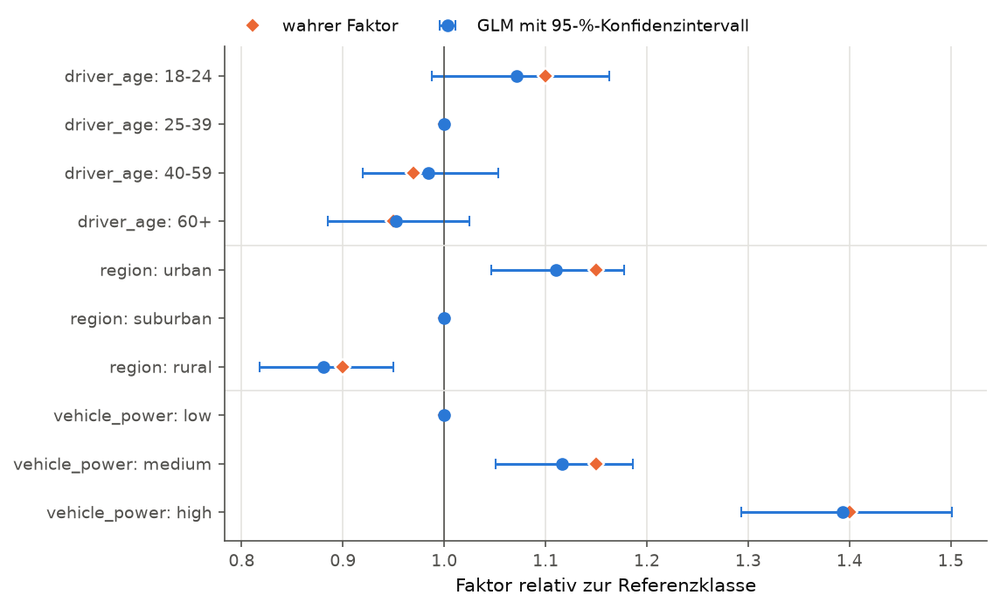
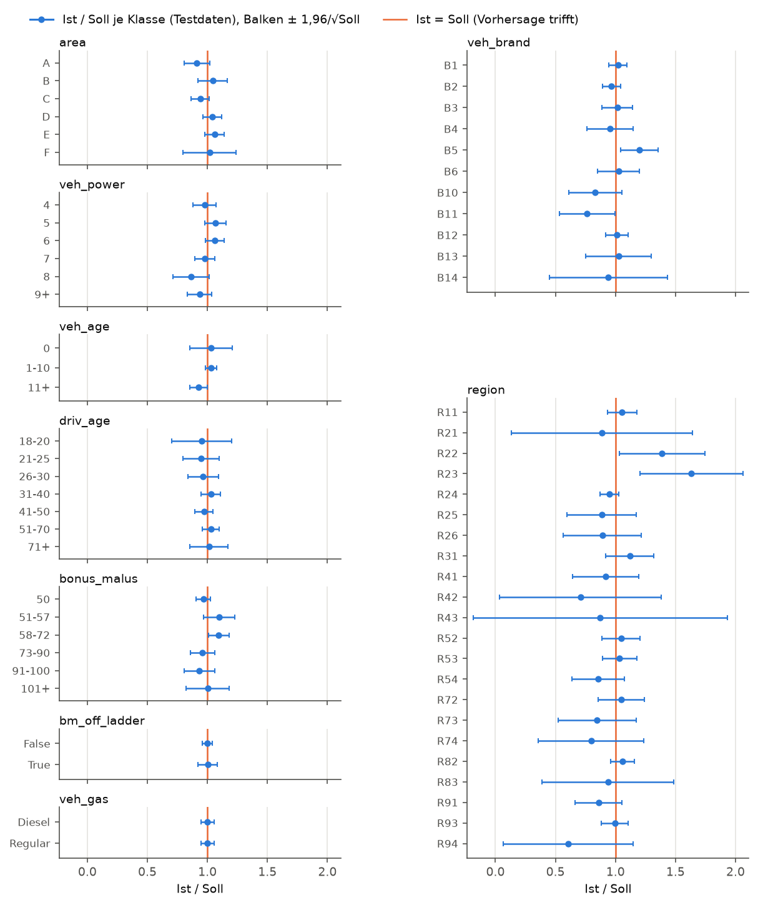
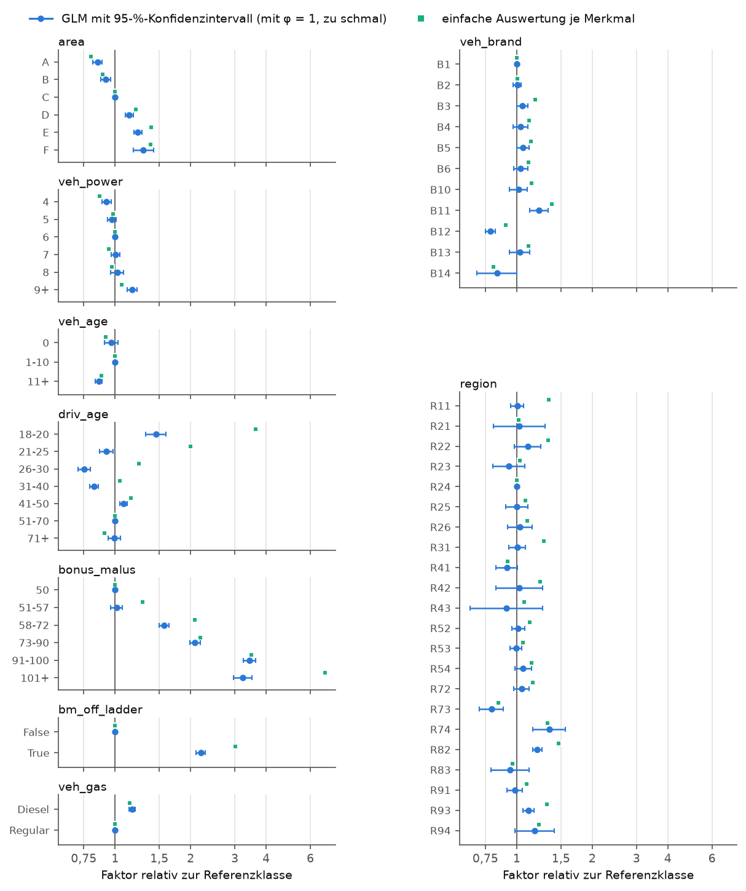

# Schadenmodellierung für ein Kfz-Portfolio

Dieses Projekt modelliert die Schäden eines simulierten Kfz-Portfolios in drei Teilen: Gesamtschaden im kollektiven Modell, Reservierung mit Chain-Ladder und Tarifierung mit Poisson- und Gamma-GLM; jede Schätzung wird gegen die bekannten wahren Parameter der Simulation geprüft. Das Frequenz-GLM läuft zusätzlich auf dem echten französischen Portfolio freMTPL2 und wird dort auf Testdaten bewertet. Es richtet sich an Leserinnen und Leser aus Aktuariat und versicherungsnaher IT.

## Ergebnisse auf einen Blick

Alle Zahlen und Grafiken stammen aus `nonlife run --seed 42` (Standardargumente: 10.000 Policen je Anfalljahr, Anfalljahre 2015–2024, Stichtag Ende 2024, 10.000 Monte-Carlo-Läufe). Der Lauf erzeugt 100.000 Policen, 7.192 Schäden und 39.426 Zahlungen. Die vollständigen Kennzahlen stehen in [`reports/results.json`](reports/results.json).

### Gesamtschaden: Simulation gegen Theorie



Die Monte-Carlo-Verteilung der Jahresschadenlast trifft den theoretischen Erwartungswert auf 0,04 % und die theoretische Standardabweichung auf 1,8 %.

| | Simulation | Theorie |
|---|---:|---:|
| $E[S]$ | 2.544.424 | 2.543.494 |
| $\mathrm{sd}[S]$ | 147.344 | 150.101 |
| 99-%-Quantil | 2.895.558 | – |

Parameter: $\hat\lambda = 719{,}2$ Schäden je Jahr, Schwere Lognormal mit $\hat\mu = 7{,}7118$, $\hat\sigma = 0{,}9582$.

### Reserve: Chain-Ladder gegen wahre Reserve



Die Chain-Ladder-Reserve liegt insgesamt 1,3 % unter der wahren Reserve; je Anfalljahr reicht die Abweichung von −6,5 % (2020) bis +3,4 % (2018), nur das fast abgewickelte Jahr 2016 weicht bei sehr kleinem Betrag stark ab (7.678 gegen 4.723). Ein Mack-Intervall fehlt noch (siehe [Geplant](#geplant)).

| | Chain-Ladder | wahr | Abweichung |
|---|---:|---:|---:|
| Reserve gesamt | 3.326.580 | 3.371.937 | −1,3 % |

### Tariffaktoren: GLM gegen wahre Faktoren



Das Poisson-GLM trifft die wahren Frequenzfaktoren; die einfache Auswertung je Merkmal ist für `vehicle_power` deutlich verzerrt (Klasse `high`: einfach 1,066, GLM 1,229, wahr 1,25), weil junge Fahrer mit hoher Frequenz überwiegend schwach motorisierte Fahrzeuge fahren und so die Referenzklasse `low` verteuern. Von den sieben geschätzten Frequenzfaktoren liegt bei einem der wahre Wert knapp außerhalb des 95-%-Intervalls: `driver_age: 60+` mit GLM 1,176, Intervall [1,103; 1,254], wahr 1,10. Bei sieben Intervallen zum Niveau 95 % ist das kein Widerspruch zum Modell.



Das Gamma-GLM trifft die wahren Schwerefaktoren; alle sieben 95-%-Intervalle enthalten den wahren Wert (z. B. `vehicle_power: high`: GLM 1,393, wahr 1,40).

### Frequenz auf echten Daten: freMTPL2

Zahlen und Grafik aus `nonlife fremtpl2 --seed 42`, vollständig in [`reports/fremtpl2.json`](reports/fremtpl2.json). Nach der Bereinigung (siehe [Daten](#daten)) bleiben 678.007 Policen mit 26.383 Schäden. Aufgeteilt wird gruppenweise in 610.450 Policen zum Schätzen und 67.557 (10,0 %) zum Testen. Wahre Faktoren gibt es hier nicht; bewertet wird die Vorhersage auf den Testdaten.

| Poisson-Devianz je Police (×10⁻²) | Training | Test |
|---|---:|---:|
| Nullmodell (eine Frequenz für alle) | 25,2614 | 25,0110 |
| GLM, 9 Merkmale, 57 Parameter | 23,7987 | 23,5531 |

Die Devianz misst, wie weit die vorhergesagten von den tatsächlichen Schadenzahlen entfernt sind; kleiner ist besser (Formel unter [Methodik](#bewertung-auf-echten-daten-evaluationpy)). Das GLM senkt sie auf den Testdaten um 5,83 % gegenüber dem Nullmodell. Das wirkt wenig, ist aber typisch: Bei einer Frequenz um 7 % ist der größte Teil der Streuung reiner Zufall, ob eine einzelne Police einen Schaden hat oder nicht, und den kann kein Merkmal erklären.

**Trifft das Modell jede Klasse?**



Ist ist die tatsächliche Zahl der Schäden einer Klasse in den Testdaten, Soll die Vorhersage des GLM für dieselben Policen. Der Balken zeigt, wie weit das Verhältnis allein durch Zufall schwankt, wenn das Modell stimmt (±1,96/√Soll, also breit bei kleinen Klassen wie R43). Schneidet der Balken den Strich bei 1, ist die Abweichung mit Zufall vereinbar.

Insgesamt gab es auf den Testdaten 2.619 Schäden bei 2.618,0 vorhergesagten. Je Klasse schneiden 59 der 65 Balken den Strich, 6 nicht. Die Balken unterstellen aber reine Poisson-Streuung, und die Daten streuen stärker: Der Schätzer der Dispersion (Verhältnis von beobachteter zu Poisson-Varianz) ist $\hat\phi = 1{,}71$. Verbreitert man die Balken entsprechend um den Faktor $\sqrt{1{,}71} \approx 1{,}31$, bleibt nur die Region R23 (Ist 34, Soll 20,8) außerhalb. Bei 65 Klassen wären etwa drei zufällige Ausreißer zu erwarten.

**Wie sehen die geschätzten Faktoren aus?**



*So liest man die Grafik:* Blau ist der Faktor des GLM, mit dem die Frequenz einer Klasse gegenüber der Referenzklasse (Faktor 1, die Klasse mit der meisten Exposure) multipliziert wird, mit 95-%-Konfidenzintervall. Grün ist die einfache Auswertung je Merkmal, also die beobachtete Frequenz der Klasse geteilt durch die der Referenzklasse, ohne die übrigen Merkmale zu berücksichtigen. Die Achse ist logarithmisch, weil Faktoren multiplikativ wirken. Wahre Faktoren gibt es nicht; die Faktoren werden deshalb auf fachliche Plausibilität geprüft. Die Intervalle rechnen mit $\phi = 1$ und sind um den Faktor 1,31 zu schmal (siehe [Grenzen](#grenzen)).

- **Bonus-Malus** ist das stärkste Merkmal: Die Frequenz steigt mit der Höhe bis zum Faktor 3,44 (91–100 gegen 50). Das selbst gebildete Merkmal `bm_off_ladder` (Wert liegt neben der Stufenleiter schadenfreier Jahre, also steckt ein früherer Schaden darin) trägt bei gleicher Höhe einen weiteren Faktor 2,19 [2,10; 2,29]. Die Klasse 101+ liegt nur scheinbar unter 91–100: Werte über 100 liegen immer neben der Leiter, zusammen also 3,23 · 2,19 ≈ 7,1.
- **Fahreralter** zeigt die Konfundierung am deutlichsten: Einfach ausgewertet haben 18- bis 20-Jährige die 3,6-fache Frequenz, im GLM nur die 1,45-fache. Junge Fahrer haben zwangsläufig einen hohen Bonus-Malus, weil sie die Leiter noch nicht hinabsteigen konnten. Die einfache Auswertung schreibt dem Alter zu, was zum großen Teil der Bonus-Malus erklärt.
- **Wohnort** (`area`, nach Bevölkerungsdichte von A bis F): Die Frequenz steigt mit der Dichte, im GLM von 0,85 (A) bis 1,30 (F) gegenüber C.

## Methodik

**Bezeichnungen, die in allen Teilen gelten.** Eine Police heißt $i$. Sie hat die Exposure $e_i$ (versicherte Zeit in Jahren, höchstens 1), die Schadenzahl $N_i$ im Beobachtungsjahr und die Tarifmerkmale $x_i$ (etwa Altersklasse und Region). $\lambda(x)$ ist die Schadenfrequenz einer Police mit den Merkmalen $x$, also die erwartete Zahl der Schäden je Versicherungsjahr; Police $i$ erwartet damit $\mu_i = e_i\thinspace\lambda(x_i)$ Schäden. $X_k$ ist die Höhe des Schadens $k$. Ein Dach wie in $\hat\lambda$ kennzeichnet einen Schätzwert.

### Kollektives Modell ([`collective.py`](src/nonlife/collective.py))

Der Jahresgesamtschaden des Portfolios ist $S = X_1 + \dots + X_N$. Dabei ist $N \sim \text{Poisson}(\lambda)$ die Zahl aller Schäden im Jahr mit Erwartungswert $\lambda$, und die Schadenhöhen $X_k$ sind unabhängig, identisch verteilt und unabhängig von $N$, mit $\log X_k \sim \mathcal{N}(\mu, \sigma^2)$ (Lognormalverteilung mit den Parametern $\mu$ und $\sigma$). Dann gilt

$$E[S] = E[N]\thinspace E[X], \qquad \mathrm{Var}[S] = E[N]\mathrm{Var}[X] + \mathrm{Var}[N]\thinspace E[X]^2 = \lambda\thinspace E[X^2],$$

wobei $X$ für eine einzelne Schadenhöhe steht; die zweite Gleichung nutzt $\mathrm{Var}[N] = E[N] = \lambda$.

Das Portfolio ist heterogen: Police $i$ hat die Schadenzahl $N_i \sim \text{Poisson}(\lambda_i)$ mit $\lambda_i = \lambda(x_i)\thinspace e_i$ und eine eigene Schwereverteilung $F_i$. Die Summe unabhängiger zusammengesetzter Poisson-Variablen ist wieder zusammengesetzt Poisson mit $\lambda = \sum_i \lambda_i$ und der Mischung $\sum_i (\lambda_i/\lambda)\thinspace F_i$ als Schwereverteilung. Daher darf das Portfolio als ein kollektives Modell behandelt werden. Geschätzt wird $\hat\lambda$ als Schadenfrequenz je Exposure-Jahr mal mittlere Exposure eines Anfalljahres, $(\hat\mu, \hat\sigma)$ per Maximum-Likelihood aus allen Einzelschäden, also Mittelwert und Standardabweichung (Divisor: Zahl der Schäden) der logarithmierten Schadenhöhen.

Die Monte-Carlo-Simulation ist vektorisiert: alle Schadenanzahlen in einem Aufruf, danach alle Schadenhöhen in einem Block, Summe je Lauf mit `np.bincount`. Zufall kommt ausschließlich aus einem übergebenen `numpy.random.Generator`.

### Reservierung ([`reserving.py`](src/nonlife/reserving.py))

Aus den Einzelzahlungen bis zum Stichtag entsteht das kumulierte Zahlungsdreieck: $C_{i,j}$ ist die Summe aller Zahlungen für Schäden des Anfalljahres $i$ bis zum Ende des Abwicklungsjahres $j$ ($j = 0$ ist das Anfalljahr selbst). Der Entwicklungsfaktor von Abwicklungsjahr $j$ nach $j+1$ wird volumengewichtet geschätzt,

$$\hat f_j = \frac{\sum_i C_{i,j+1}}{\sum_i C_{i,j}},$$

summiert über alle Anfalljahre $i$, für die beide Werte beobachtet sind. Ist $I$ das Jahr des Stichtags, dann ist $C_{i,I-i}$ der letzte beobachtete Wert des Anfalljahres $i$ (die Diagonale des Dreiecks). Mit $J$ als letztem Abwicklungsjahr (hier $J = 9$) sind der geschätzte Endschaden $\hat C_{i,J}$ und die Reserve $\hat R_i$

$$\hat C_{i,J} = C_{i,I-i} \prod_{j \ge I-i} \hat f_j, \qquad \hat R_i = \hat C_{i,J} - C_{i,I-i}.$$

Die wahre Reserve je Anfalljahr ist der simulierte Endschaden minus die bis zum Stichtag gezahlten Beträge. Die Chain-Ladder-Funktionen sind gegen das Paket [`chainladder`](https://github.com/casact/chainladder-python) auf dem RAA-Dreieck getestet (Schadendaten der Reinsurance Association of America, 1991, ein Standardbeispiel u. a. bei Mack 1994); das Paket wird nur in den Tests verwendet.

### Tarifierung ([`pricing.py`](src/nonlife/pricing.py))

Jedes Merkmal $m$ (etwa Region) hat endlich viele Klassen $\ell$ (etwa Stadt, Land); $x_{im}$ ist die Klasse von Police $i$ im Merkmal $m$. Je Merkmal ist eine Klasse die Referenz. Die Frequenz wird mit einem Poisson-GLM mit Log-Link geschätzt:

$$\log E[N_i] = \log e_i + \beta_0 + \sum_m \beta_{m, x_{im}}.$$

Dabei ist $\beta_0$ die logarithmierte Frequenz einer Police, die in jedem Merkmal in der Referenzklasse liegt, und $\beta_{m,\ell}$ der Zuschlag der Klasse $\ell$ im Merkmal $m$ auf der Log-Skala ($\beta_{m,\ell} = 0$ für die Referenzklasse). $\log e_i$ ist ein Offset: ein Summand mit festem Koeffizienten 1, weil $E[N_i]$ proportional zur Exposure ist (doppelte versicherte Zeit, doppelt so viele erwartete Schäden). Der Tariffaktor der Klasse ist $e^{\hat\beta_{m,\ell}}$; mit ihm wird die Frequenz gegenüber der Referenzklasse multipliziert.

Die Schwere wird mit einem Gamma-GLM mit Log-Link auf den Einzelschäden geschätzt, $\log E[X_k] = \gamma_0 + \sum_m \gamma_{m, x_{km}}$, wobei $x_{km}$ die Klasse der Police ist, zu der Schaden $k$ gehört, und $\gamma$ die Koeffizienten wie oben. Das Gamma-GLM unterstellt $\mathrm{Var}[X_k] = \phi\thinspace E[X_k]^2$, also einen konstanten Variationskoeffizienten $\sqrt\phi$. Das gilt für die simulierten lognormalen Schäden, sodass die Schätzer als Quasi-Likelihood-Schätzer konsistent sind. Die Dispersion $\phi$ wird über die Pearson-Statistik geschätzt.

Die Designmatrix (eine Zeile je Police, eine Spalte je Koeffizient: Einsen für $\beta_0$, sonst 0/1 für „Police liegt in Klasse $\ell$“) wird selbst gebaut, damit die Referenzklasse frei wählbar ist. Das Konfidenzintervall eines Faktors ist $\exp(\hat\beta \pm z_{1-\alpha/2}\thinspace \widehat{\mathrm{se}})$ mit dem Standardfehler $\widehat{\mathrm{se}}$ von $\hat\beta$ und dem Quantil $z_{1-\alpha/2}$ der Standardnormalverteilung (1,96 für 95 %). Es ist symmetrisch auf der Log-Skala und deshalb asymmetrisch um den Faktor. Zum Vergleich wird die einfache Auswertung je Merkmal $(N_\ell/E_\ell)/(N_\text{ref}/E_\text{ref})$ gezeigt, mit $N_\ell$ und $E_\ell$ als Summe der Schäden und der Exposure aller Policen der Klasse $\ell$; sie entspricht einem Poisson-GLM mit nur diesem Merkmal. Geschätzt wird mit `statsmodels`.

### Bewertung auf echten Daten ([`evaluation.py`](src/nonlife/evaluation.py))

Ohne wahre Parameter zählt die Vorhersage auf Policen, die das Modell nicht gesehen hat. Die Policen werden 90/10 in Trainings- und Testdaten geteilt, und zwar gruppenweise: Policen mit identischen Merkmalen bilden eine Gruppe und landen gemeinsam auf einer Seite (Begründung unter [Daten](#daten)). Geschätzt wird nur auf den Trainingsdaten; Referenz je Merkmal ist dort die Klasse mit der größten Exposure. Für jede der $n$ Policen der Testdaten sagt das GLM dann $\hat\mu_i = e_i\thinspace\hat\lambda(x_i)$ Schäden voraus. Maß ist die mittlere Poisson-Devianz

$$D = \frac{1}{n} \sum_{i=1}^{n} 2 \left[ N_i \log \frac{N_i}{\hat\mu_i} - (N_i - \hat\mu_i) \right], \qquad 0 \cdot \log 0 = 0.$$

Jeder Summand ist 0, wenn $\hat\mu_i = N_i$, und wächst, je weiter Vorhersage und Beobachtung auseinanderliegen; für eine Police ohne Schaden ist er $2\hat\mu_i$. $D$ ist das Doppelte der mittleren Differenz der Log-Likelihood zwischen einem Modell, das jede Police genau trifft, und dem geschätzten Modell. Es ist also das Kriterium, das das GLM beim Schätzen minimiert, ausgewertet auf neuen Daten. Vergleich ist das Nullmodell, das allen Policen dieselbe Frequenz gibt.

Je Klasse eines Merkmals wird die Summe der beobachteten Schäden $\sum N_i$ (Ist) mit der Summe der vorhergesagten $\sum \hat\mu_i$ (Soll) verglichen, summiert über die Policen der Klasse. Auf den Trainingsdaten sind beide für jede Klasse im Modell exakt gleich: Das besagt die Score-Gleichung des Poisson-GLM, $X^\top (N - \hat\mu) = 0$, mit der Designmatrix $X$ und den Vektoren $N$ und $\hat\mu$ aller Policen; jede Spalte von $X$ markiert eine Klasse. Aussagekräftig ist der Vergleich daher nur auf den Testdaten.

Die Poisson-Annahme $\mathrm{Var}[N_i] = E[N_i]$ wird mit dem Pearson-Schätzer der Dispersion geprüft,

$$\hat\phi = \frac{1}{n-p} \sum_{i=1}^{n} \frac{(N_i - \hat\mu_i)^2}{\hat\mu_i},$$

hier auf den $n$ Policen der Trainingsdaten mit $p$ geschätzten Koeffizienten. Jeder Summand vergleicht die beobachtete quadrierte Abweichung mit der Poisson-Varianz $\hat\mu_i$. Unter der Poisson-Annahme ist $\phi = 1$; $\hat\phi > 1$ heißt Überdispersion, die Daten streuen stärker als Poisson.

## Daten

- **Synthetisches Portfolio** ([`simulate.py`](src/nonlife/simulate.py)): Tarifmerkmale `driver_age`, `region` und `vehicle_power`, wobei `vehicle_power` bewusst von `driver_age` abhängt. Frequenz und mittlere Schadenhöhe sind multiplikativ in den Merkmalen, die wahren Faktoren sind bekannt (`default_parameters`). Schadenanzahl Poisson mit Exposure, Schadenhöhe lognormal mit festem Variationskoeffizienten. Jeder Schaden wird über zehn Abwicklungsjahre ausgezahlt; die Zahlungsanteile sind Dirichlet-verteilt um ein festes Abwicklungsmuster, damit die Entwicklungsfaktoren zwischen Anfalljahren streuen. Zahlungen nach dem Stichtag werden abgeschnitten und liefern die wahre Reserve.
- **freMTPL2** ([`fremtpl2.py`](src/nonlife/fremtpl2.py)): französisches Kfz-Haftpflicht-Portfolio eines Beobachtungsjahres aus dem R-Paket CASdatasets (Version 1.0-8), geladen von OpenML ([freMTPL2freq, ID 41214](https://www.openml.org/d/41214), eine Zeile je Police; [freMTPL2sev, ID 41215](https://www.openml.org/d/41215), eine Zeile je Schaden) und unter `data/openml/` zwischengespeichert.
  - **Bereinigung** nach Wüthrich und Merz (2023, Anhang B): Die Schadenzahl `ClaimNb` ist für viele Policen fehlerhaft (zu ihnen gibt es keine Schadenhöhen). Sie wird deshalb aus der Anzahl der Schadenhöhen neu berechnet; das ändert sie bei 9.117 Policen, davon 8.851 mit Policennummer ≤ 24.500. Keine Police wird dafür entfernt, sonst fielen nur Policen mit Schaden weg und die Frequenz sänke. Entfernt werden 6 Policen mit mehr als 5 Schäden (vermutlich Datenfehler) und 195 Schäden ohne Police; die Exposure wird bei 1 Jahr gekappt (1.224 Policen). Ergebnis: 678.007 Policen, 26.383 Schäden, wie bei Wüthrich und Merz.
  - **Klassen:** Fahrzeugstärke, Fahrzeug- und Fahreralter wie bei Noll, Salzmann und Wüthrich (2018). `Area` (A–F) ist im Datensatz bereits eine Einteilung der Bevölkerungsdichte (A: bis 50, F: über 10.000 Einwohner/km²); deshalb geht `Area` ein und `Density` nicht, beide zusammen wären fast kollinear. Der Bonus-Malus (französischer Schadenfreiheitsrabatt: Start bei 100, je schadenfreiem Jahr mal 0,95 bis zum Boden 50, je Schaden mal 1,25) geht als zwei Merkmale ein: seine Höhe in sechs Klassen und `bm_off_ladder`, ob der Wert neben der Stufenleiter 100, 95, 90, …, 51, 50 liegt, also ein Schaden in der Vergangenheit steckt.
  - **Gruppenweise Aufteilung:** Vertragsverlängerungen im Lauf des Jahres stehen als getrennte Zeilen im Datensatz (Wüthrich und Merz 2023). 38 % der Policen haben einen „Zwilling“ mit identischen Merkmalen; bei Paaren ist die Summe der Exposure in 96 % der Fälle höchstens 1 und der Abstand der Policennummern im Median 1. Bei einer Aufteilung je Zeile läge der Zwilling einer Testpolice meist im Training, und die Testdevianz wäre zu optimistisch.

  Quellen: M. V. Wüthrich, M. Merz (2023), *Statistical Foundations of Actuarial Learning and its Applications*, Springer, Anhang B ([Open Access](https://doi.org/10.1007/978-3-031-12409-9_13)); A. Noll, R. Salzmann, M. V. Wüthrich (2018), *Case Study: French Motor Third-Party Liability Claims* ([SSRN 3164764](https://papers.ssrn.com/sol3/papers.cfm?abstract_id=3164764)).

Erzeugte und heruntergeladene Daten liegen unter `data/` und werden nicht eingecheckt.

## Installation und Reproduktion

Python 3.11 oder neuer.

```bash
python -m venv .venv
source .venv/bin/activate        # Windows: .venv\Scripts\activate
pip install -e ".[dev]"

nonlife run                      # Seed 42; erzeugt data/, reports/results.json, reports/figures/
pytest
ruff check .
mypy src

pip install -e ".[fremtpl]"      # optional: scikit-learn zum Laden von freMTPL2
nonlife fremtpl2                 # lädt beim ersten Lauf von OpenML; reports/fremtpl2.json
pytest -m network                # Kontrollwerte der Bereinigung auf den echten Daten
```

Die Tests laufen ohne Netz und ohne scikit-learn; die Bereinigung wird dort an kleinen künstlichen Tabellen geprüft, in denen jede Police einen Fall abdeckt.

## Grenzen

- **Schwere im kollektiven Modell:** Für das gesamte Portfolio wird eine einzige Lognormalverteilung angepasst. Die wahre Schwere ist eine Mischung von Lognormalverteilungen über die Tarifklassen.
- **Zahlungs- statt Aufwandsdreieck:** Es gibt keine Spätmeldungen und keine Einzelfallreserven; jeder Schaden ist im Anfalljahr bekannt. Die Reserve ist hier die Summe der ausstehenden Zahlungen, kein IBNR im engeren Sinn.
- **Kein Tail-Faktor:** Das Abwicklungsmuster endet nach zehn Jahren und damit innerhalb des Dreiecks.
- **Keine Inflation, stationäres Portfolio:** Muster, Faktoren und Portfoliogröße sind über alle Anfalljahre gleich.
- **Synthetische, korrekt spezifizierte Daten:** Die GLMs schätzen genau die Modellklasse, aus der die Daten stammen. Fehlspezifikation, Interaktionen und Großschäden kommen nicht vor; deshalb läuft das Frequenzmodell zusätzlich auf freMTPL2.
- **Tarifierung auf Endschäden:** Die GLMs auf der Simulation verwenden die simulierten Endschäden aller Anfalljahre. In der Praxis wären die jungen Jahre noch offen; man würde den Aufwand auf Endschaden hochrechnen (etwa mit den Faktoren aus der Reservierung) oder nur abgewickelte Jahre verwenden.
- **freMTPL2, Überdispersion:** Das Frequenz-GLM rechnet mit $\phi = 1$, geschätzt ist $\hat\phi = 1{,}71$. Die Faktoren bleiben konsistent, ihre Konfidenzintervalle sind aber zu schmal. Quasi-Poisson oder Negativ-Binomial sind der nächste Schritt.
- **freMTPL2, ein Beobachtungsjahr:** Validiert wird auf anderen Policen desselben Jahres, nicht auf einem Folgejahr. Wie gut der Tarif in die Zukunft trägt, misst das nicht.
- **freMTPL2, Annahmen der Aufbereitung:** Die neu berechnete Schadenzahl unterstellt, dass eine Police ohne Schadenhöhe keinen Schaden hatte. Doppelt erfasste Verträge werden nur näherungsweise über gleiche Merkmale erkannt. Die Klassengrenzen wurden auf allen Daten gewählt, nicht nur auf den Trainingsdaten. Modelliert ist bisher nur die Frequenz; ob `ClaimAmount` abgewickelte Endschäden enthält, ist nicht dokumentiert.

## Geplant

- **Gradient Boosting als Messlatte für das GLM** (scikit-learn, Poisson-Verlust, Zielgröße $N/e$ mit Gewicht $e$ statt Offset), auf derselben Aufteilung: Wie viel Vorhersagekraft lässt das GLM liegen? Dabei auch die Aufteilung je Zeile zum Vergleich, um das Leck durch doppelt erfasste Verträge zu messen.
- **Wechselwirkungen finden und ins GLM übernehmen:** im Boosting-Modell nur auf den Trainingsdaten suchen (Partial Dependence, H-Statistik nach Friedman), als Merkmal ins GLM aufnehmen, auf den Testdaten prüfen.
- **Überdispersion:** Quasi-Poisson oder Negativ-Binomial für das Frequenz-GLM auf freMTPL2.
- **Schwere-GLM auf freMTPL2** mit Behandlung der Großschäden (Kappung oberhalb einer Schwelle, Überschuss auf alle Policen umgelegt).
- **Standardfehler der Reserve nach Mack (1993)** mit Intervall in der Reservegrafik, geprüft an Macks veröffentlichtem Beispiel und angewendet auf echte Dreiecke der CAS Loss Reserving Database, die auch die tatsächliche spätere Abwicklung enthält.
- **Panjer-Rekursion** mit diskretisierter Schwere, Vergleich der Quantile und der Laufzeit mit Monte Carlo.

## Entstehung

Für die fachliche Kernlogik hat Linus Plümer Signaturen, fachliche Annahmen und Tests festgelegt und freigegeben; implementiert wurde sie mit Claude Code; die gemeinsamen Reviews laufen. Bei freMTPL2 hat er die Entscheidungen zur Aufbereitung getroffen (Bereinigung, Klassen, Bonus-Malus als zwei Merkmale, gruppenweise Aufteilung, Bewertung über die Testdevianz). Projektstruktur, Tooling, CLI und Grafiken stammen weitgehend von Claude Code.
